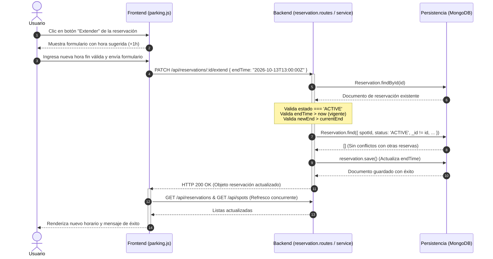
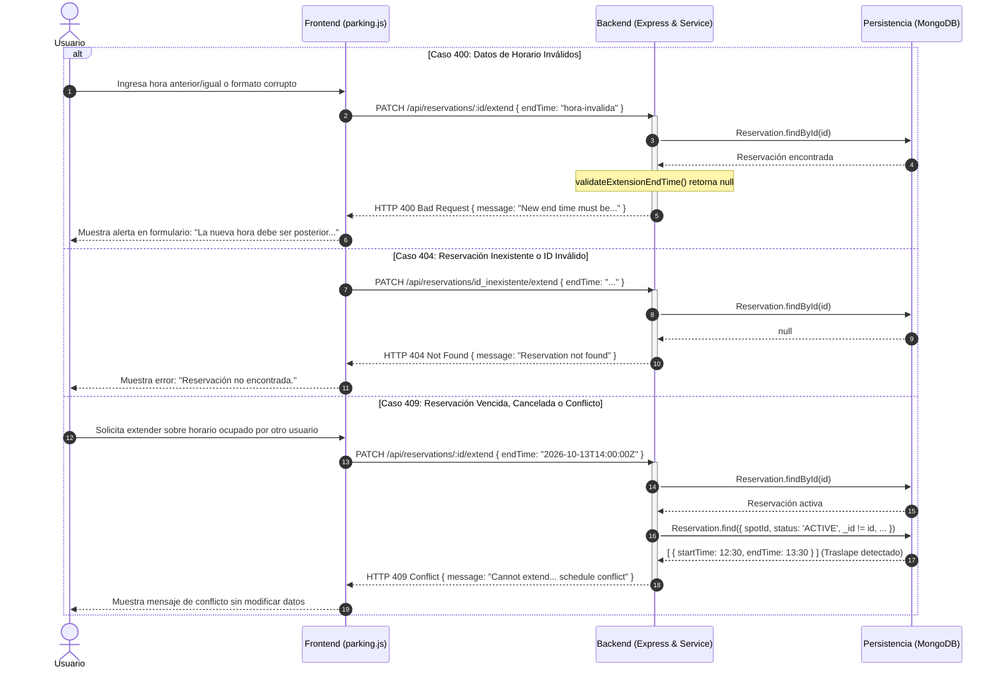
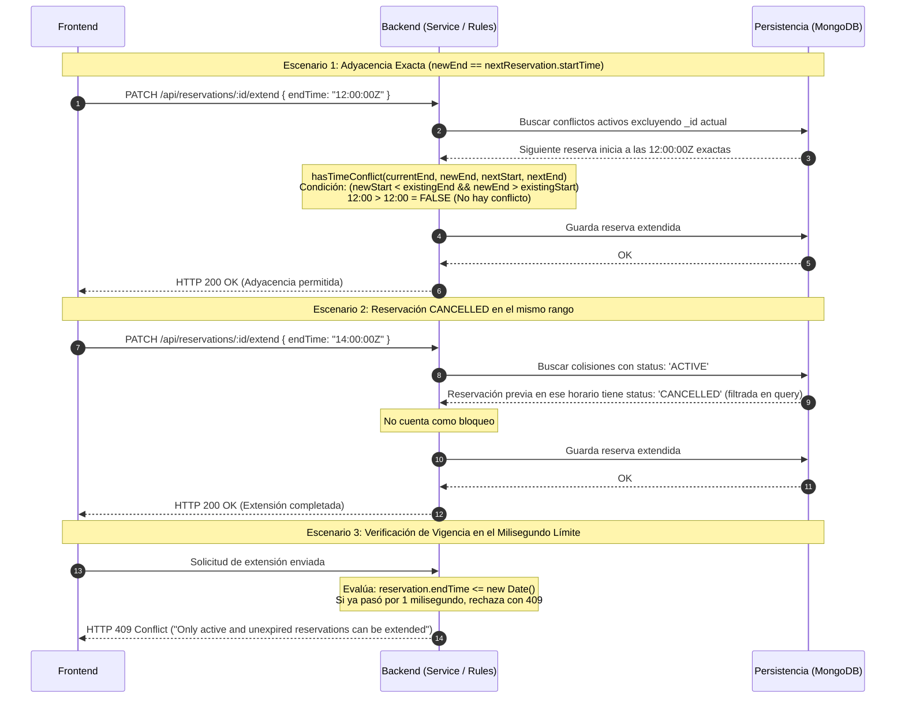

# Flujos de Extensión de Reservaciones (Feature Extension)

Este documento describe las interacciones entre el **Usuario**, el cliente web (**Frontend**), el servidor Express (**Backend**) y la base de datos (**MongoDB / Persistencia**).

---

## 1. Happy Path: Extensión Exitosa (HTTP 200)

Flujo en el que la reservación existe, está `ACTIVE`, sigue vigente, el nuevo horario es posterior al actual, no existe colisión con otras reservas del mismo espacio y los cambios se persisten.

---

## 2. Error Cases: Validación y Reglas de Negocio (HTTP 400, 404, 409)

Representación de los caminos de error estipulados por los lineamientos HTTP de la feature.

---

## 3. Edge Cases: Casos Límite y Adyacencia

Validación de condiciones de frontera:
1. **Adyacencia exacta**: La extensión finaliza justo cuando inicia la siguiente reserva activa (permitida).
2. **Exclusión de reservas canceladas**: Reservaciones `CANCELLED` no bloquean el rango extendido.
3. **No auto-conflicto**: El rango original de la misma reserva no compite contra su propia extensión.

